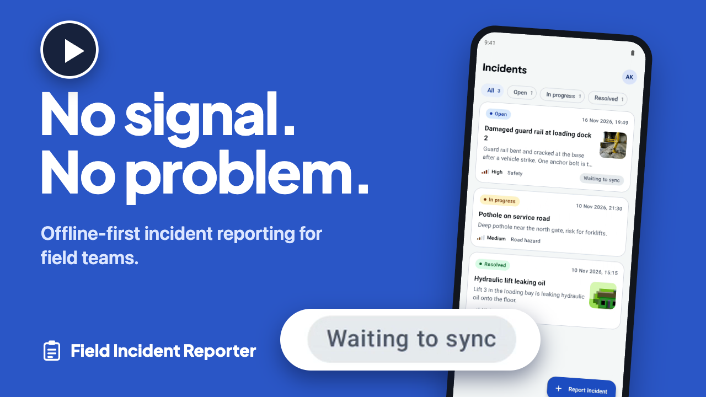
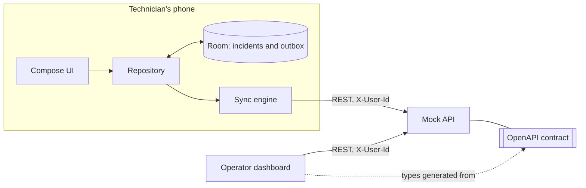
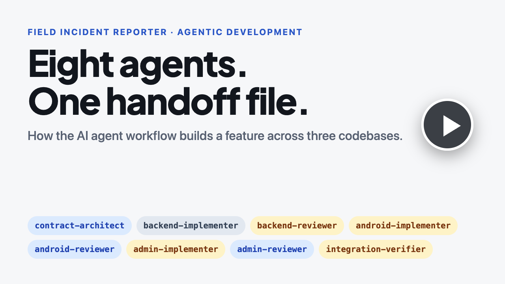

# Field Incident Reporter

Field Technicians photograph and report physical incidents (broken equipment, road hazards) from a phone, even with no signal. Operators triage them on a web dashboard.

This is a monorepo with three apps that share one API contract:

| App | Path | Used by | Runs on |
| --- | --- | --- | --- |
| Mobile app | [`mobile/`](mobile) | Technicians | Android and iOS |
| Mock API | [`backend/`](backend) | both clients | Node, port 3000 |
| Operator dashboard | [`admin/`](admin) | Operators | Browser, port 3001 |

## Contents

- [What it does](#what-it-does)
- [Architecture](#architecture)
- [Technology stack](#technology-stack)
- [Project structure](#project-structure)
- [Prerequisites](#prerequisites)
- [Getting started](#getting-started)
- [Configuration](#configuration)
- [API and platform integration](#api-and-platform-integration)
- [Testing and quality](#testing-and-quality)
- [Development guidelines](#development-guidelines)
- [Contributing](#contributing)
- [Agentic development](#agentic-development)
- [Troubleshooting](#troubleshooting)
- [Status and known limits](#status-and-known-limits)
- [More documentation](#more-documentation)

## What it does

- **Report an Incident:** title, description, Category, Severity, location (GPS or an address) and one to five photos, compressed on the device before upload.
- **View, edit, delete:** a Technician can change or delete an Incident only while it is *Open*. Deleting has a confirmation and a five-second undo.
- **Work offline:** every change is saved on the device first and synced later, with retry and backoff.
- **Triage:** Operators filter and search Incidents (including the unassigned ones), open one, assign it, move it through *Open → In progress → Resolved*, and record how it was resolved.

### Watch: the product in two minutes

[](https://winechit-dev.github.io/field-incident-reporter/feature-video.html)

*[Feature video](https://winechit-dev.github.io/field-incident-reporter/feature-video.html) (2 min, with subtitles): one Incident from an offline report on the phone, through sync, to triage and resolution on the dashboard, and back to the Technician.*

The app and dashboard footage is recorded from the real apps against the local API. The opening shots and the Incident photo are AI-generated illustrations, not a real site. Still screenshots of every screen, including dark mode: [`docs/screenshots/`](docs/screenshots).

## Architecture



Three decisions shape the code:

1. **Contract first.** [`backend/openapi.yaml`](backend/openapi.yaml) is the source of truth for every request, response and error. The dashboard's API types are generated from it, the mobile DTOs follow it by hand, and the backend has a test for each documented status code.
2. **Offline-first, and the server wins a Conflict.** On the phone, Room is the source of truth. Every change is saved locally and queued in an outbox, which a sync engine pushes in order. Creating an Incident is idempotent by a client-generated UUID, so a retry never duplicates. If an Operator has already picked up an Incident when a Technician's offline edit arrives, the server answers `409`, the edit is discarded, and the Incident shows the server's version marked *Sync failed*. Reasoning: [ADR 0002](docs/adr/0002-offline-first-sync-server-wins.md).
3. **One shared UI on two platforms.** Android and iOS share the screens, view models, data and sync code through Kotlin Multiplatform and Compose Multiplatform. Camera, location, photo compression and background sync sit behind small interfaces with native implementations. Reasoning: [ADR 0001](docs/adr/0001-shared-compose-multiplatform-ui.md).

## Technology stack

| Area | Technology | Used for |
| --- | --- | --- |
| Mobile | Kotlin 2.4, Kotlin Multiplatform | One codebase for Android and iOS |
| | Compose Multiplatform, Material 3 | Shared screens |
| | Room (bundled SQLite) | Local database: Incidents and the outbox |
| | Ktor client | HTTP (OkHttp on Android, Darwin on iOS) |
| | Koin | Dependency injection |
| | WorkManager, Play Services Location (Android) | Background sync, GPS |
| | Coil | Loading photos |
| | Gradle 9.5 (wrapper), AGP 9.1 | Build |
| Backend | Node, Express, json-server 0.17 | Mock API: json-server serves reads, an Express layer enforces the rules |
| | multer | Photo uploads |
| | `node:test` | API tests |
| Admin | Next.js 16 (App Router), React 19, TypeScript | Dashboard |
| | Tailwind CSS 4, shadcn/ui | Styling and components |
| | `openapi-typescript`, `openapi-fetch` | API types and client generated from the contract |
| | Vitest, ESLint | Tests and linting |
| Contract | OpenAPI 3.0 | The API definition all three apps follow |

Exact versions: [`mobile/gradle/libs.versions.toml`](mobile/gradle/libs.versions.toml), [`backend/package.json`](backend/package.json), [`admin/package.json`](admin/package.json).

## Project structure

```
field-incident-reporter/
├── backend/                  Mock API
│   ├── openapi.yaml          The API contract (source of truth)
│   ├── src/app.js            Every endpoint and rule
│   ├── src/server.js         Entry point; reset.js restores the seed data
│   ├── seed.json             Demo data: four users, one Incident per Status
│   ├── test/api.test.js      API tests
│   └── uploads/              Uploaded photos (git-ignored)
├── admin/                    Operator dashboard (Next.js)
│   └── src/
│       ├── api/              Typed API client; schema.d.ts is generated
│       ├── app/              Routes: /sign-in, /incidents, /incidents/[id]
│       ├── components/       App components; ui/ holds shadcn/ui primitives
│       ├── lib/              Pure logic (filters, triage, overview) and its tests
│       ├── integration/      Tests that run against a real API (*.itest.ts)
│       └── proxy.ts          Redirects to sign-in when no Operator is chosen
├── mobile/                   Kotlin Multiplatform app
│   ├── core/domain/          Models, rules, repository interfaces (pure Kotlin)
│   ├── core/data/            Room, Ktor client, sync engine, repositories
│   ├── feature/incidents/    Shared Compose screens and view models
│   ├── shared/               Builds the iOS framework; iOS platform code
│   ├── androidApp/           Android entry point and platform code
│   ├── iosApp/               Xcode project that hosts the shared framework
│   └── gradle/libs.versions.toml   All dependency versions
├── docs/
│   ├── adr/                  Architecture decision records
│   ├── agents/               Development process: lifecycle, gates, standards
│   ├── design/               Design system shared by the app and the dashboard
│   ├── handoffs/             One file per feature: criteria, status, evidence
│   └── screenshots/
├── scripts/
│   ├── integration/run-integration.sh   Cross-app scenarios against a real API
│   ├── check-forbidden-terms.sh         Required before every handoff
│   └── check-agents.sh                  Checks the AI-agent workflow files
├── .claude/                  AI agent definitions, skills and commands
├── AGENTS.md                 Project rules for AI agents (CLAUDE.md points here)
└── GLOSSARY.md               Domain terms
```

Mobile module dependencies point inward:

| Module | Holds | May depend on |
| --- | --- | --- |
| `:core:domain` | models, rules, repository and scheduler interfaces | coroutines only |
| `:core:data` | Room, Ktor, `SyncEngine`, repositories, DTOs | `:core:domain` |
| `:feature:incidents` | screens, view models, `PlatformCapabilities` | `:core:domain` |
| `:shared` | the iOS framework and iOS platform code | all of the above |
| `:androidApp`, `iosApp` | entry points, platform implementations, DI start-up | all |

Each app has its own README with more detail: [`backend/README.md`](backend/README.md), [`admin/README.md`](admin/README.md), [`mobile/README.md`](mobile/README.md).

## Prerequisites

| Tool | Version | Needed for |
| --- | --- | --- |
| Node.js | 22.12 or later, 24, or 26 (developed with 26) | Backend and dashboard |
| JDK | 21 (developed with 21) | Mobile build |
| Android Studio with the Android SDK | SDK platform 37; the app runs on Android 7.0 (API 24) and later | Android app |
| Android emulator or device | | Running the Android app |
| Xcode | Developed with 26.2, on an Apple silicon Mac | iOS app (optional) |
| `curl`, `bash` | | The integration script |
| Python 3, Ruby | | Optional: `scripts/check-agents.sh` and the contract parse check |

You can run the backend and dashboard with Node alone. The mobile toolchain is only needed for the app.

## Getting started

```bash
git clone https://github.com/winechit-dev/field-incident-reporter.git
cd field-incident-reporter
```

Start the three apps in this order, each in its own terminal.

### 1. The API (port 3000)

```bash
cd backend
npm install
npm start
```

Check it: `curl http://localhost:3000/users` lists the four seeded users. The data lives in `backend/db.json`, created from `seed.json` on first start. To go back to the seed data and clear uploaded photos, stop the server, run `npm run reset`, and start it again.

### 2. The dashboard (port 3001)

```bash
cd admin
npm install
npm run dev
```

Open <http://localhost:3001> and choose an Operator on the sign-in page (Mya Sandar or Htet Naing). There is no password. No `.env` file is needed for the default setup; see [Configuration](#configuration).

### 3. The Android app

Start an emulator first, then either open `mobile/` in Android Studio and run `androidApp`, or:

```bash
cd mobile
./gradlew :androidApp:installDebug
```

Open **Field Reporter** on the emulator and choose a Technician (Aung Kyaw or Thiri Win). The emulator reaches the API on your machine at `http://10.0.2.2:3000`.

The command line needs to know where the Android SDK is: set `ANDROID_HOME`, or let Android Studio create `mobile/local.properties` by opening the project once.

### 4. The iOS app (optional)

Open `mobile/iosApp/iosApp.xcodeproj` in Xcode, pick an iPhone simulator and run. Xcode builds the shared Kotlin framework through Gradle, so the first build takes a few minutes. The simulator reaches the API at `http://localhost:3000`. See [Status and known limits](#status-and-known-limits) for what has been verified on iOS.

### A short tour

1. In the app, report an Incident with a photo and your location.
2. Open the dashboard: it appears in the list. Open it, then choose **Start work**.
3. In the app, pull to refresh: the Incident now shows *In progress*.
4. Turn the emulator's network off, report another Incident, and watch it show *Waiting to sync*. Turn the network back on and it syncs by itself.

### Production builds

```bash
cd admin && npm run build && npm start        # production dashboard on port 3001
cd mobile && ./gradlew :androidApp:assembleDebug   # APK in androidApp/build/outputs/apk/debug/
```

The backend is a mock for local development and has no build step.

## Configuration

Everything works with the defaults. All settings are optional.

| Setting | Where | Default | Purpose |
| --- | --- | --- | --- |
| `PORT` | backend, environment variable | `3000` | API port |
| `DB_FILE` | backend, environment variable | `backend/db.json` | Data file |
| `API_BASE_URL` | admin, `admin/.env.local` (copy [`.env.example`](admin/.env.example)) | `http://localhost:3000` | Where the dashboard's server finds the API |
| `INTEGRATION_PORT` | `scripts/integration/run-integration.sh` | `3100` | Port of the throwaway API the script starts |
| Android API URL | `BASE_URL` in [`FieldReporterApp.kt`](mobile/androidApp/src/main/kotlin/dev/fieldreporter/FieldReporterApp.kt) | `http://10.0.2.2:3000` | Constant in code |
| iOS API URL | `BASE_URL` in [`IosApp.kt`](mobile/shared/src/iosMain/kotlin/dev/fieldreporter/IosApp.kt) | `http://localhost:3000` | Constant in code |

The mobile API URLs are constants, not build settings. If you move the API to another port, change them too.

## API and platform integration

Both clients talk to the same REST API and never to each other. A change made on one side reaches the other on its next fetch: the app pulls on sync and pull-to-refresh, the dashboard on page load.

**The full contract is [`backend/openapi.yaml`](backend/openapi.yaml).** Paste it into any OpenAPI viewer to browse it. In short:

| Method and path | Who | Purpose |
| --- | --- | --- |
| `GET /users` | anyone (no header needed) | The seeded users, for the "choose who you are" picker |
| `GET /incidents` | any user | List, with filters, search, sorting and paging |
| `POST /incidents` | Technician | Report an Incident; idempotent by client-generated `id` |
| `GET /incidents/{id}` | any user | One Incident |
| `PATCH /incidents/{id}` | Technician or Operator | Technician edits content while `OPEN`; Operator changes `status`, `assignee`, `resolutionNote` |
| `DELETE /incidents/{id}` | Technician (reporter, `OPEN` only) | Delete; `204` even if already gone |
| `POST /incidents/{id}/photos` | Technician (reporter, `OPEN` only) | Upload a JPEG or PNG (10 MB at most, five per Incident) |
| `DELETE /incidents/{id}/photos/{photoId}` | Technician (reporter, `OPEN` only) | Remove a photo |
| `GET /uploads/<file>` | anyone | The photo files |

**Identity.** There is no login. Every request carries an `X-User-Id` header with a seeded user's id, except `GET /users` and `/uploads/*`. The user's role decides what they may do.

```bash
curl http://localhost:3000/users
curl -H 'X-User-Id: u-op-1' 'http://localhost:3000/incidents?status=OPEN&_page=1&_limit=20'
```

The seeded ids are `u-tech-1`, `u-tech-2` (Technicians) and `u-op-1`, `u-op-2` (Operators).

**Errors** are always `{ "error": { "code": "UPPER_SNAKE", "message": "..." } }`. Clients branch on `code`, never on `message`.

| Status | Meaning | Example `code` |
| --- | --- | --- |
| `401` | Missing or unknown `X-User-Id` | `UNAUTHENTICATED`, `UNKNOWN_USER` |
| `403` | Wrong role, or not the reporter | `FORBIDDEN` |
| `404` | Not found | `NOT_FOUND` |
| `409` | Conflict: the Incident is no longer `OPEN`, or the id belongs to someone else | `NOT_OPEN`, `ID_TAKEN` |
| `422` | Validation failed, unknown field, or photo limit reached | `VALIDATION_ERROR`, `PHOTO_LIMIT` |

**How each app follows the contract**

| App | Shared models | When the contract changes |
| --- | --- | --- |
| Backend | Rules in `src/app.js` | Implement the change and add a test per status code |
| Admin | `src/api/schema.d.ts`, generated, never hand-edited | Run `npm run gen:api` in `admin/` and commit the result |
| Mobile | DTOs and mappers in `mobile/core/data/.../remote/`, written by hand | Update them field by field. A new enum value needs a mapper change, because unknown values are not ignored |

Conventions shared by all three (camelCase JSON, `UPPER_SNAKE` enums, ISO-8601 UTC timestamps, idempotent writes) are in [`docs/agents/standards.md`](docs/agents/standards.md). How to change the contract safely: [`docs/agents/contract-change.md`](docs/agents/contract-change.md).

## Testing and quality

Run each block from the repository root. There is no CI; run these locally before you push.

**Backend**

```bash
cd backend && npm test
```

API tests on Node's test runner. Each starts a real server on a free port with a temporary copy of the seed data, so they never touch `db.json`.

**Dashboard**

```bash
cd admin && npm run typecheck && npm run lint && npm test && npm run build
```

Vitest unit tests cover the pure logic in `src/lib/` (filters, triage, overview counts).

**Mobile**

```bash
cd mobile
./gradlew :core:domain:allTests :core:data:testAndroidHostTest :core:data:iosSimulatorArm64Test
./gradlew :feature:incidents:testAndroidHostTest :feature:incidents:iosSimulatorArm64Test :shared:iosSimulatorArm64Test
./gradlew :androidApp:assembleDebug :shared:linkDebugFrameworkIosSimulatorArm64
./gradlew :androidApp:lintDebug
```

The tests cover the domain rules, the sync state machine (offline create, retry after a lost response, Conflict handling, photo ordering) and the view models, on both the Android host and the iOS simulator. The `iosSimulatorArm64` tasks need Xcode; without a Mac, run the `testAndroidHostTest` tasks and `:androidApp:assembleDebug`.

**Across the apps**

```bash
scripts/integration/run-integration.sh
```

Runs the five cross-app scenarios (report to triage, an Operator's change reaching the phone, Conflicts on edit and on delete, an offline create) with the app's real sync engine, the real API and the dashboard's real code. It starts its own API on port 3100, so nothing else needs to be running. It needs `npm install` done in `backend/` and `admin/`.

**Repository checks**

```bash
scripts/check-forbidden-terms.sh    # must exit 0 before every handoff
scripts/check-agents.sh             # after changing .claude/, AGENTS.md or docs/agents/
```

The full list of what must be green before a change counts as done is in [`docs/agents/quality-gates.md`](docs/agents/quality-gates.md).

## Development guidelines

**Use the glossary.** [`GLOSSARY.md`](GLOSSARY.md) defines Incident, Technician, Operator, Status, Severity, Category, Sync State and Conflict. Use those words, with one meaning each, in code, tests, UI copy and docs.

**Change the contract before the code.** Any change to a request, response or error starts in `backend/openapi.yaml`. Keep changes additive: new optional fields, new endpoints. A breaking change needs an ADR and a new path version.

**Stay in one lane per change.** Backend, mobile and admin are separate lanes with separate rules. Read the lane's `AGENTS.md` before you start: [`backend/AGENTS.md`](backend/AGENTS.md), [`mobile/AGENTS.md`](mobile/AGENTS.md), [`admin/AGENTS.md`](admin/AGENTS.md). They are written for AI agents but apply equally to people.

**Domain rules every app honours**

- Only Operators change Status, assignee and Resolution Note.
- A Technician edits, deletes or changes photos only while the Incident is `OPEN`.
- An Incident has at most five photos.
- On a Conflict the server version wins.

**Architecture rules**

- *Mobile:* dependencies point inward (see the module table above). `commonMain` has no platform imports; platform behaviour goes behind an interface. Every write lands in Room and the outbox first.
- *Backend:* each rule lives in `src/app.js` next to its endpoint. Server-owned fields (`createdAt`, `updatedAt`, `reportedBy`, `activityLog`, `resolvedAt`) are never read from client input.
- *Admin:* pure logic goes in plain functions under `src/lib/`; components stay thin. Filters live in the URL.

**Code and naming**

- Small modules with narrow interfaces, tested through the interface.
- Names say what a thing is in the domain. Comments explain why, not what.
- No secrets and no real personal data in seeds or tests.
- Package and bundle ids start with `dev.fieldreporter`.
- UI colours, Status and Severity tones and date formats follow the shared [design system](docs/design/design-system.md). A value changed on one platform is changed on the other in the same task.

**Git**

- Branch from `main`. Lane branches for a feature are named `<id>-<lane>`, for example `014-mobile`, where the id is the handoff file's number.
- Commit messages follow the existing history: `feat: …`, `fix(mobile): …`, `test(admin): …`, `docs: …`, with one logical change per commit.
- Merge order for a cross-lane feature: contract → backend → mobile and admin (in either order) → integration check. Details: [`docs/agents/parallel-work.md`](docs/agents/parallel-work.md).

Full shared standards: [`docs/agents/standards.md`](docs/agents/standards.md).

## Contributing

Every feature follows the same seven steps: **plan → contract → implement → verify → review → document → handoff**. Each step and its completion criterion is in [`docs/agents/lifecycle.md`](docs/agents/lifecycle.md). In practice:

1. **Plan.** Copy [`docs/handoffs/_template.md`](docs/handoffs/_template.md) to `docs/handoffs/<id>-<slug>.md`. Write the goal and the acceptance criteria as Given/When/Then, each naming the lane that proves it. The existing handoffs are worked examples; [`005-unassigned-filter.md`](docs/handoffs/005-unassigned-filter.md) covers all lanes.
2. **Contract.** If a request, response or error changes, update `backend/openapi.yaml` first and record the change in the handoff.
3. **Implement, red first.** Write a failing test for each criterion, then the smallest change that makes it pass. Backend goes first; mobile and admin can then proceed in parallel.
4. **Verify.** Run your lane's commands from [Testing and quality](#testing-and-quality) and paste the output into the handoff under "Evidence". Check a UI change on an emulator or in a browser against the running API.
5. **Review.** Someone who did not write the change reviews it against the handoff criteria, the contract and the lane's rules. Findings are a `blocker` or a `nit`; a change merges with zero blockers.
6. **Document.** Update the lane README if commands, setup or behaviour changed, `GLOSSARY.md` for a new domain term, and this README if anything it describes changed. Add an ADR only for a choice that is hard to reverse.
7. **Hand off.** Set the lane's status in the handoff file and run `scripts/integration/run-integration.sh` when the change touches sync, DTOs, the contract, filters or triage.

**Before you open a pull request**

- [ ] Each acceptance criterion maps to a named, passing test.
- [ ] The lane's gates are green ([`quality-gates.md`](docs/agents/quality-gates.md)).
- [ ] `npm run gen:api` in `admin/` leaves no diff, if the contract changed.
- [ ] `scripts/check-forbidden-terms.sh` exits 0. The public repo must contain no reference to the assessing company.
- [ ] READMEs match the code.

**Working with AI agents.** These steps can be run by specialised agents, one per lane. See [Agentic development](#agentic-development).

## Agentic development

The repo is set up to be built with [Claude Code](https://claude.com/claude-code) agents: one specialised agent per lane, one handoff file per feature, and a reviewer on a stronger model than the author. This section is the summary. The full guide, with every workflow and copy-ready prompts, is [`docs/agents/README.md`](docs/agents/README.md).

### Watch: the agent workflow explained

[](https://winechit-dev.github.io/field-incident-reporter/agent-workflow-explainer.html)

*[Agent workflow explainer](https://winechit-dev.github.io/field-incident-reporter/agent-workflow-explainer.html) (4 min 41 s, with subtitles): the agents, the commands, the lifecycle, which model runs each agent, which skills each one loads, and a real feature run from [`005-unassigned-filter.md`](docs/handoffs/005-unassigned-filter.md).*

### How it works

You run each step from the main Claude Code session with one of four commands. Agents never start each other; the handoff file in [`docs/handoffs/`](docs/handoffs) carries the state between them.

| Command | Runs | Result |
| --- | --- | --- |
| `/plan-feature <description>` | `contract-architect` | A handoff file with acceptance criteria, and the contract change |
| `/implement <backend\|mobile\|admin> <handoff file>` | that lane's implementer | Tests and code in the lane, gate output in the handoff |
| `/review <backend\|mobile\|admin> <handoff file>` | that lane's reviewer | A verdict with `blocker` and `nit` findings |
| `/verify-integration <handoff file>` | `integration-verifier` | A verdict per acceptance criterion across the lanes |

### Agents and models

| Agent | Responsibility | Writes | Model |
| --- | --- | --- | --- |
| `contract-architect` | Plans a feature and changes the contract | `backend/openapi.yaml`, `GLOSSARY.md`, `docs/adr/`, handoff files | `opus` |
| `backend-implementer` | Endpoints, rules, seed data, API tests | `backend/` | `haiku` |
| `backend-reviewer` | Reviews a backend diff | nothing | `sonnet` |
| `android-implementer` | The Kotlin Multiplatform app, Android and iOS | `mobile/` | `sonnet` |
| `android-reviewer` | Reviews a mobile diff | nothing | `opus` |
| `admin-implementer` | The Next.js dashboard | `admin/` | `sonnet` |
| `admin-reviewer` | Reviews an admin diff | nothing | `opus` |
| `integration-verifier` | Checks a finished feature across the lanes | nothing | `sonnet` |

The model names are Claude Code aliases set in each file under [`.claude/agents/`](.claude/agents). Implementers run on the cheaper model because they produce most of the tokens; each reviewer runs one tier higher so the check does not share the author's blind spots. To use a stronger model for one task, say so in the prompt (`Run /implement mobile on <handoff> with model opus`); `/implement` already does this for sync-engine, Room-schema and authorization changes. Reasons, overrides and cost guidelines: [Models](docs/agents/README.md#models).

### Skills

Eleven skills in [`.claude/skills/`](.claude/skills) hold the project knowledge for one kind of work. Some are preloaded into an agent; the rest load on demand, or when you type the name (`/mobile-debugging`).

| Lane | Skills |
| --- | --- |
| Backend | `backend-api`, `backend-review` |
| Mobile | `mobile-architecture`, `mobile-testing`, `mobile-data-sync`, `mobile-compose-ui`, `mobile-debugging`, `mobile-review` |
| Admin | `admin-architecture`, `admin-ui`, `admin-review` |

What each covers and which agent loads it: [Skills](docs/agents/README.md#skills).

### Which workflow to use

| The task | Do this | Guide |
| --- | --- | --- |
| A new feature | `/plan-feature`, then `/implement` per lane (backend first), `/review` per lane, `/verify-integration` | [Feature development](docs/agents/README.md#feature-development) |
| A bug | Investigate read-only, reproduce with a failing test, then fix in the main session (small) or through a handoff and `/implement` (larger) | [Bug fixing](docs/agents/README.md#bug-fixing) |
| A change that touches the API | Always `/plan-feature` first, so the contract changes before any lane | [Cross-platform work](docs/agents/README.md#cross-platform-work) |
| Mobile and admin work on one feature | Run both `/implement` commands in parallel, each in its own worktree, after backend is merged | [Cross-platform work](docs/agents/README.md#cross-platform-work) |
| Checking finished work | `/review <lane> <handoff>`, never the agent that wrote it | [Review and quality assurance](docs/agents/README.md#review-and-quality-assurance) |
| A question, a typo, a one-line fix | Ask or fix in the main session; an agent is not worth its start-up cost | [Agent or main session](docs/agents/README.md#agent-or-main-session) |

### Example prompts

```
/plan-feature Operators can mark an Incident as urgent, and Technicians see an Urgent label in the app
```

```
/implement backend docs/handoffs/010-incident-priority.md
```

```
Run /implement mobile and /implement admin on docs/handoffs/010-incident-priority.md in parallel,
each in its own git worktree.
```

```
/review mobile docs/handoffs/010-incident-priority.md
```

```
/mobile-debugging An Incident stays on "Waiting to sync" after the emulator comes back online.
Find the cause and show me the reproduction before fixing anything.
```

```
Without changing any files, explain how the dashboard decides which fields "Start work" sends,
and where that is tested.
```

`010-incident-priority.md` is an example name; yours is whatever `/plan-feature` creates.

### Ground rules

- An agent writes only in its own lane. A need in another lane goes into the handoff, never into an edit.
- Only `contract-architect` edits `backend/openapi.yaml`.
- Review in a fresh context, whichever model wrote the code.
- Raise the model for hard tasks, not for all tasks.
- After changing anything under `.claude/`, `AGENTS.md` or `docs/agents/`, run `scripts/check-agents.sh`.

## Troubleshooting

| Symptom | Cause and fix |
| --- | --- |
| `EADDRINUSE` when starting the API or the dashboard | Port 3000 or 3001 is taken. Stop the other process (`lsof -i :3000`), or start the API with `PORT=3005 npm start` and set `API_BASE_URL` in `admin/.env.local` to match. |
| The dashboard shows an "API unavailable" panel | The backend is not running, or `API_BASE_URL` points elsewhere. Start `backend/` first, then choose **Try again**. |
| The dashboard keeps returning to the sign-in page | No Operator is chosen in this browser yet. The choice is kept in a cookie, so a private window or cleared cookies asks again. |
| Data looks wrong, or an Incident is stuck from an earlier session | Stop the API, run `npm run reset` in `backend/`, start it again. On the phone, clear the app's data or reinstall, because it keeps its own local copy. |
| Every API call returns `401` | The `X-User-Id` header is missing or is not a seeded id. See `curl http://localhost:3000/users`. |
| The Android app cannot load users or sync | The API is not running on port 3000, or you are on a physical device. `10.0.2.2` only works from the emulator; for a device, change `BASE_URL` to your computer's address on the local network. |
| An Incident stays on *Waiting to sync* | The app cannot reach the API. Check the emulator's network and the backend terminal, then pull to refresh. |
| An Incident shows *Sync failed* | Usually a Conflict: an Operator moved it out of *Open* before the edit arrived. This is expected; the server's version is shown. |
| Gradle: `SDK location not found` | Set `ANDROID_HOME`, or open `mobile/` in Android Studio once so it writes `local.properties`. |
| Gradle fails on the JDK version | Use JDK 21: check `java -version` and `JAVA_HOME`. |
| `iosSimulatorArm64Test` tasks fail or are missing | They need Xcode on an Apple silicon Mac; the project has no Intel simulator target. Run the Android host tests instead. |
| `npm run gen:api` leaves a diff in `schema.d.ts` | The contract changed and the types were not regenerated. Commit the result. |
| `npm test` in `admin/` fails to start on an older Node | Vitest needs Node 22.12 or later. |
| Admin integration tests do not run with `npm test` | By design. They need a real API and run through `scripts/integration/run-integration.sh`. |
| A mobile build or test fails for no clear reason | Try `./gradlew --stop`, then run the task again with `--stacktrace`. The `mobile-debugging` skill in [`.claude/skills/`](.claude/skills/mobile-debugging/SKILL.md) has a fuller diagnosis loop. |

Problems with the AI-agent workflow: [`docs/agents/README.md`](docs/agents/README.md#troubleshooting).

## Status and known limits

| Area | State |
| --- | --- |
| Backend | Complete for the contract. Verified against both clients. |
| Android app | Report, view, edit, delete, offline sync, camera and gallery, location, WorkManager sync. Run on an emulator. |
| Dashboard | Sign-in, filterable list with overview tiles, detail page, triage actions. Run in a browser. |
| iOS app | Shares all screens and logic with Android. Checked in the simulator: sign-in, location (with the permission prompt), gallery photo with compression, reporting, offline retry with backoff, pull-to-refresh, edit, and delete with undo ([`004-ios-verification.md`](docs/handoffs/004-ios-verification.md)). **Not verified:** a real camera capture (the simulator's camera takes no photo) and the background tasks (iOS does not run them in the simulator). |

Not built:

- **Real authentication.** The API trusts the `X-User-Id` header. This is a local mock, not a deployable backend.
- **Automated UI and real-device tests.** The cross-app logic is automated ([`003-integration-check.md`](docs/handoffs/003-integration-check.md)); what the screens show is checked by hand.
- **CI.** All checks run locally.
- **Bulk actions** in the dashboard, and a **map pin** for adjusting a location in the app. The camera uses the system camera app, not an in-app viewfinder.

## More documentation

| Topic | Where |
| --- | --- |
| API contract | [`backend/openapi.yaml`](backend/openapi.yaml) |
| Backend commands and behaviour | [`backend/README.md`](backend/README.md) |
| Dashboard layout, filters and triage behaviour | [`admin/README.md`](admin/README.md) |
| Mobile modules, sync and screens | [`mobile/README.md`](mobile/README.md) |
| Domain terms | [`GLOSSARY.md`](GLOSSARY.md) |
| Architecture decisions | [`docs/adr/`](docs/adr) |
| Design system | [`docs/design/design-system.md`](docs/design/design-system.md) |
| Development lifecycle | [`docs/agents/lifecycle.md`](docs/agents/lifecycle.md) |
| Quality gates | [`docs/agents/quality-gates.md`](docs/agents/quality-gates.md) |
| Shared standards | [`docs/agents/standards.md`](docs/agents/standards.md) |
| Contract changes | [`docs/agents/contract-change.md`](docs/agents/contract-change.md) |
| Parallel work, branches and merge order | [`docs/agents/parallel-work.md`](docs/agents/parallel-work.md) |
| Agentic development guide: workflows, agents, skills, models | [`docs/agents/README.md`](docs/agents/README.md) |
| Agent matrix: inputs, outputs and model reasons per agent | [`docs/agents/agent-matrix.md`](docs/agents/agent-matrix.md) |
| Project rules for agents | [`AGENTS.md`](AGENTS.md) |
| Feature history, with criteria and evidence | [`docs/handoffs/`](docs/handoffs) |
