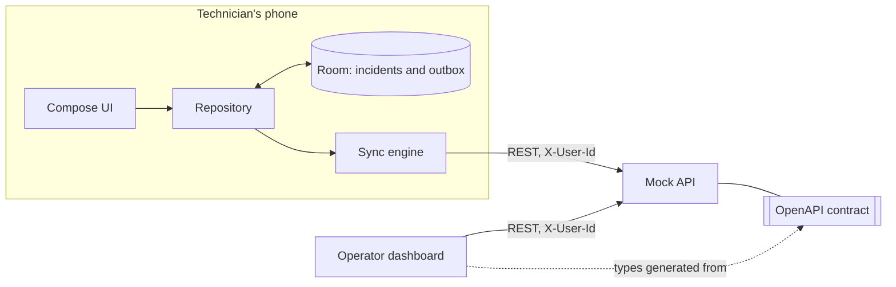

# Field Incident Reporter

Field technicians photograph and report physical incidents (broken equipment, road hazards) from a phone, even with no signal. Operators triage them on a web dashboard.

This is a monorepo with three parts that share one API contract:

| Part | Path | Stack |
| --- | --- | --- |
| Mobile app (Android, iOS) | [`mobile/`](mobile) | Kotlin Multiplatform, Compose Multiplatform, Room, Ktor |
| Mock API | [`backend/`](backend) | json-server plus an Express rules layer |
| Operator dashboard | [`admin/`](admin) | Next.js (App Router), TypeScript, Tailwind, shadcn/ui |



## Run it

You need Node and a JDK (developed with Node 26 and JDK 21). For Android, the Android SDK and an emulator; for iOS, Xcode.

**1. The API** (port 3000)

```
cd backend
npm install
npm start          # npm run reset restores the seed data
```

**2. The dashboard** (port 3001)

```
cd admin
npm install
npm run dev
```

Choose an Operator on the sign-in page (Mya Sandar or Htet Naing). There is no password.

**3. The Android app**

Open `mobile/` in Android Studio and run `androidApp`, or `cd mobile && ./gradlew :androidApp:installDebug`. The emulator reaches the API at `http://10.0.2.2:3000`. Choose a Technician (Aung Kyaw or Thiri Win) on the first screen.

For iOS, open `mobile/iosApp` in Xcode. See [Status](#status) for what works there.

**A short tour**

1. In the app, report an incident with a photo and your location.
2. Open the dashboard: it appears in the list. Open it, then choose **Start work**.
3. In the app, pull to refresh: the incident now shows *In progress*.
4. Turn the emulator's network off, report another incident, and watch it show *Waiting to sync*. Turn the network back on and it syncs by itself.

## What it does

- **Report an incident:** title, description, category, severity, location (GPS or an address) and one to five photos, compressed on the device before upload.
- **View, edit, delete:** a technician can change or delete an incident only while it is *Open*. Deleting has a confirmation and a five-second undo.
- **Works offline:** every change is saved on the device first and synced later, with retry and backoff.
- **Triage:** operators filter and search incidents, open one, assign it, move it through *Open → In progress → Resolved*, and record how it was resolved.

## How it is built

**Contract first.** [`backend/openapi.yaml`](backend/openapi.yaml) is the source of truth. The dashboard's API types are generated from it, and the mobile DTOs follow it. The backend enforces the rules and has a test for each documented status code.

**Offline-first with the server winning conflicts.** Room is the app's source of truth, with an outbox of pending changes that a sync engine pushes in order. Creating an incident is idempotent by a client-generated UUID, so retries never duplicate. If an operator has already picked up an incident when a technician's offline edit reaches the server, the server answers `409`, the edit is discarded, the server's version is shown, and the incident is marked *Sync failed* with the reason.

**One shared UI on two platforms.** The mobile app uses Kotlin Multiplatform with Compose Multiplatform, so Android and iOS share the screens, view models, data and sync code. Camera, location, photo compression and background sync sit behind small interfaces with native implementations.

| Mobile module | Role |
| --- | --- |
| `:core:domain` | models, rules, repository interfaces |
| `:core:data` | Room, Ktor, sync engine, repositories |
| `:feature:incidents` | screens and view models |
| `:shared` | builds the iOS framework |
| `:androidApp`, `iosApp` | app entry points and platform code |

The reasoning behind the two big choices is written down:
[shared Compose Multiplatform UI](docs/adr/0001-shared-compose-multiplatform-ui.md) and
[offline-first sync, server wins](docs/adr/0002-offline-first-sync-server-wins.md).
Domain terms (Incident, Technician, Operator, Sync State, Conflict) are defined in [`GLOSSARY.md`](GLOSSARY.md).

## Tests

```
cd backend && npm test                                  # 13 API tests
cd admin && npm run typecheck && npm run lint && npm test && npm run build   # 27 tests
cd mobile && ./gradlew :core:domain:allTests :core:data:testAndroidHostTest \
  :core:data:iosSimulatorArm64Test :feature:incidents:testAndroidHostTest :androidApp:testDebugUnitTest
```

The mobile tests include the sync state machine (offline create, retry after a lost response, conflict handling, photo ordering), run on both the Android host and the iOS simulator.

## Working with AI agents

The repo includes a workflow for coding agents working on the three parts in parallel without stepping on each other: one lane per part, changes to the contract made first and by one agent, handoff files, and quality gates per lane. Start at [`AGENTS.md`](AGENTS.md). The per-lane guides are [`backend/AGENTS.md`](backend/AGENTS.md), [`mobile/AGENTS.md`](mobile/AGENTS.md) and [`admin/AGENTS.md`](admin/AGENTS.md), and the shared process lives in [`docs/agents/`](docs/agents).

## Status

| Area | State |
| --- | --- |
| Backend | Complete for the contract. Verified against both clients. |
| Android app | Report, view, edit, delete, offline sync, camera and gallery, location, WorkManager sync. Run on an emulator. |
| Dashboard | Sign-in, filterable list, detail page, triage actions. Run in a browser. |
| iOS app | Builds and links, and shares all screens and logic. Its camera, location, photo compression and background sync are **not implemented yet**, so reports can't carry photos or coordinates there, and sync runs once without retry. Not yet run in the simulator. |
| Not built | A demo video and screenshots, an automated cross-app integration test, filtering for unassigned incidents, and real authentication (the API trusts an `X-User-Id` header). |

Smaller deviations from the original plan: the camera uses the system camera app instead of CameraX, and there is no map pin for adjusting a location.
