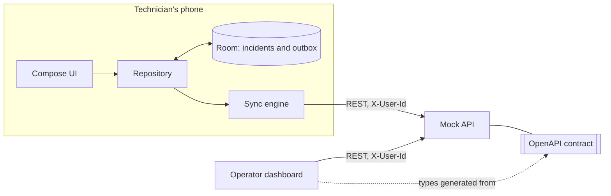
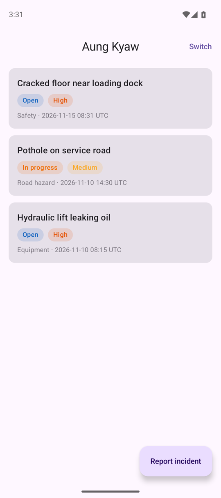
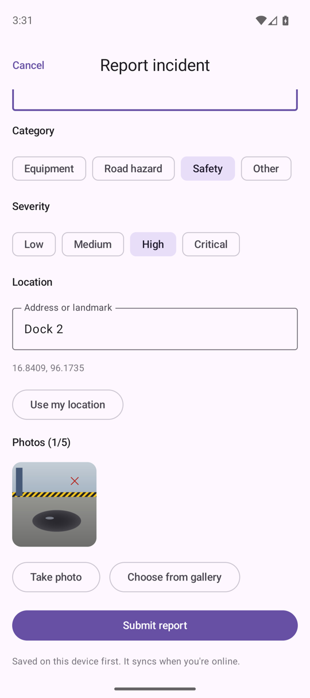
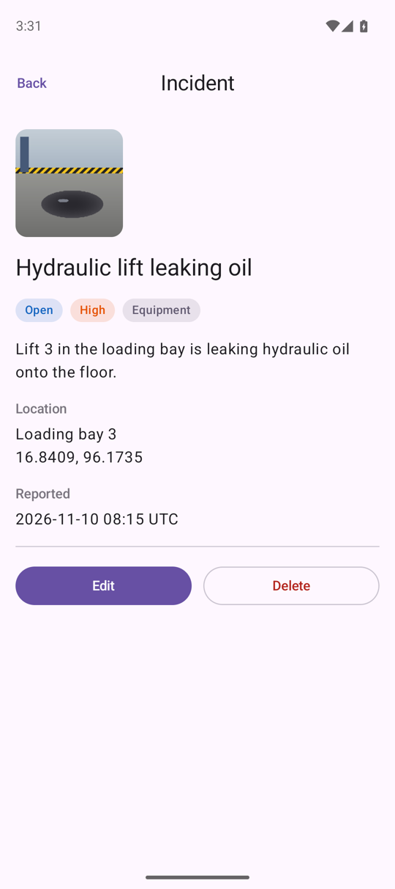
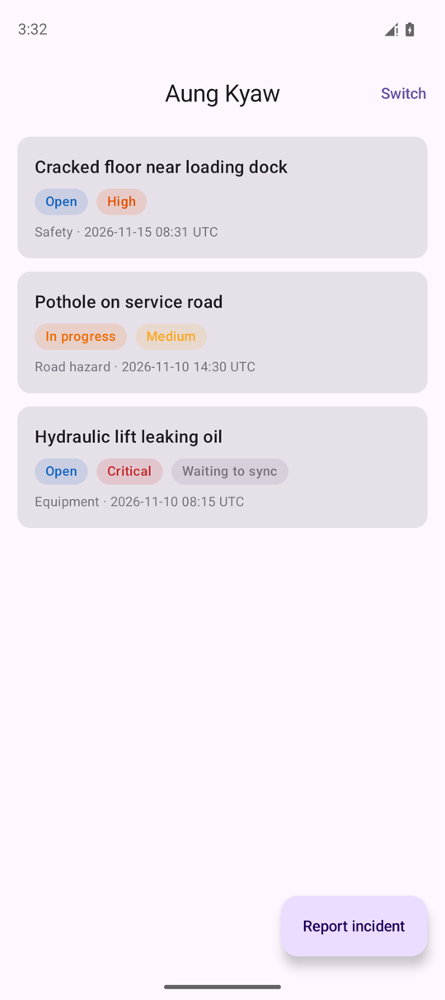
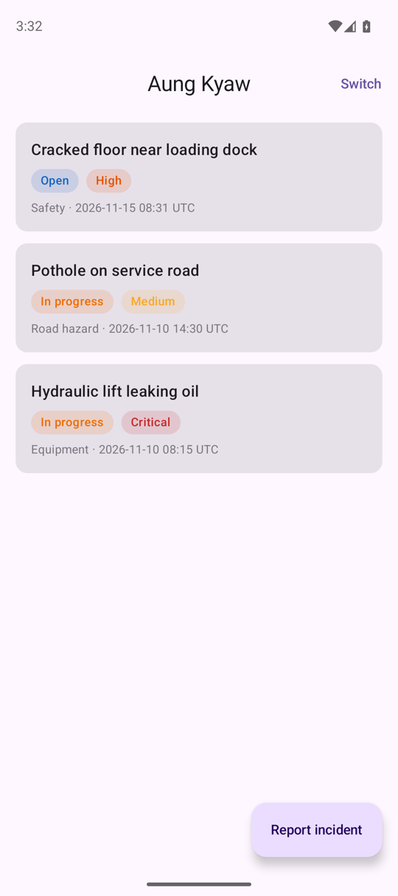
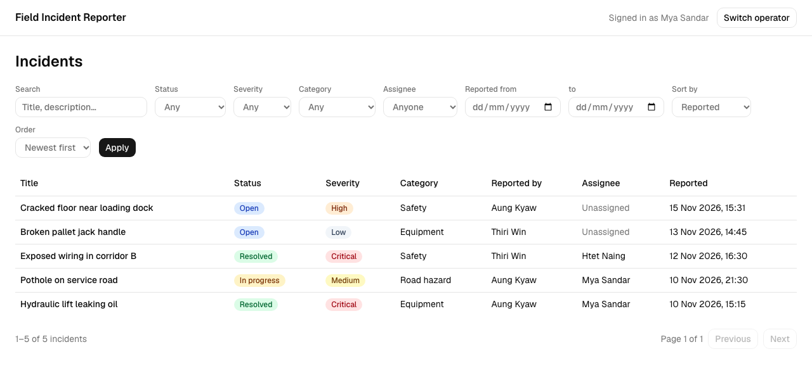
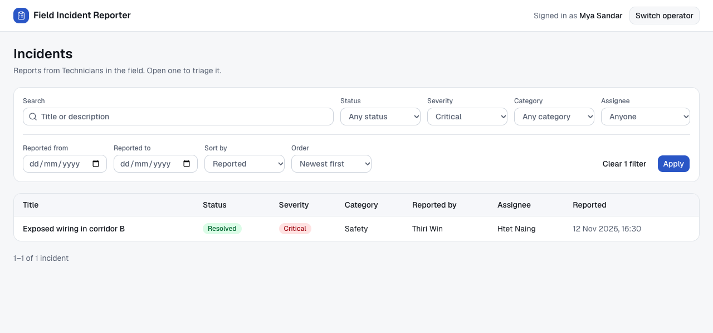
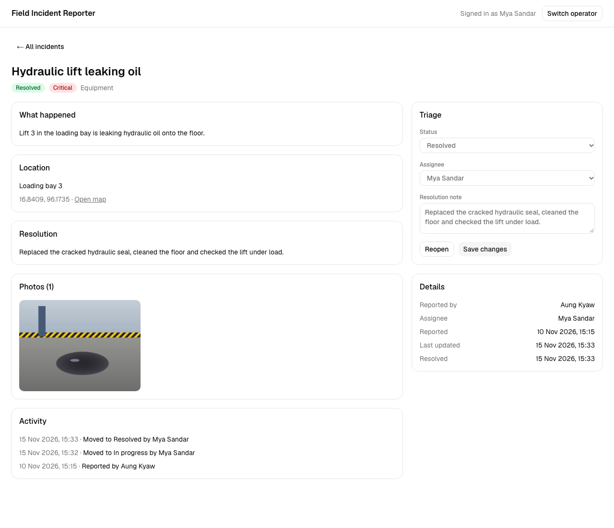
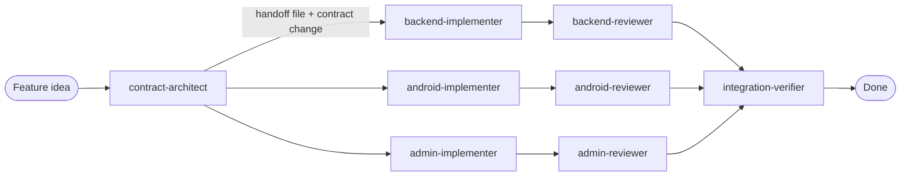

# Field Incident Reporter

Field technicians photograph and report physical incidents (broken equipment, road hazards) from a phone, even with no signal. Operators triage them on a web dashboard.

This is a monorepo with three parts that share one API contract:

| Part | Path | Stack |
| --- | --- | --- |
| Mobile app (Android, iOS) | [`mobile/`](mobile) | Kotlin Multiplatform, Compose Multiplatform, Room, Ktor |
| Mock API | [`backend/`](backend) | json-server plus an Express rules layer |
| Operator dashboard | [`admin/`](admin) | Next.js (App Router), TypeScript, Tailwind, shadcn/ui |



## Contents

- [Screenshots](#screenshots)
- [Run it](#run-it)
- [What it does](#what-it-does)
- [How it is built](#how-it-is-built)
- [Tests](#tests)
- [Working with AI agents](#working-with-ai-agents): [agents](#agents), [skills](#skills), [using it](#using-it), [troubleshooting](#troubleshooting)
- [Status](#status)

## Screenshots

**The phone app (Android).** A technician reports an incident with a photo and GPS location, edits one while offline, and later sees the operator's progress.

<table>
  <tr>
    <td align="center" valign="top"><br><sub>The list. The incident just reported from the phone is at the top, already synced.</sub></td>
    <td align="center" valign="top"><br><sub>Reporting: category, severity, GPS location and a compressed photo.</sub></td>
    <td align="center" valign="top"><br><sub>Detail, with the photo loaded from the server.</sub></td>
    <td align="center" valign="top"><br><sub>Edited with no network: saved on the device, <em>Waiting to sync</em>.</sub></td>
    <td align="center" valign="top"><br><sub>Back online and refreshed: the operator's <em>In progress</em>, and the offline edit has synced.</sub></td>
  </tr>
</table>

**The operator dashboard.** Filters live in the URL, and an operator triages from the detail page.


*All incidents, including the one reported from the phone above.*


*Filtering by severity.*


*An incident that was started and resolved from the dashboard: resolution note, photo and activity log.*

The photos in these screenshots are a drawn placeholder, not a real site photo.

## Run it

You need Node and a JDK (developed with Node 26 and JDK 21). For Android, the Android SDK and an emulator; for iOS, Xcode.

**1. The API** (port 3000)

```
cd backend
npm install
npm start          # npm run reset restores the seed data
```

**2. The dashboard** (port 3001)

```
cd admin
npm install
npm run dev
```

Choose an Operator on the sign-in page (Mya Sandar or Htet Naing). There is no password.

**3. The Android app**

Open `mobile/` in Android Studio and run `androidApp`, or `cd mobile && ./gradlew :androidApp:installDebug`. The emulator reaches the API at `http://10.0.2.2:3000`. Choose a Technician (Aung Kyaw or Thiri Win) on the first screen.

For iOS, open `mobile/iosApp` in Xcode. See [Status](#status) for what works there.

**A short tour**

1. In the app, report an incident with a photo and your location.
2. Open the dashboard: it appears in the list. Open it, then choose **Start work**.
3. In the app, pull to refresh: the incident now shows *In progress*.
4. Turn the emulator's network off, report another incident, and watch it show *Waiting to sync*. Turn the network back on and it syncs by itself.

## What it does

- **Report an incident:** title, description, category, severity, location (GPS or an address) and one to five photos, compressed on the device before upload.
- **View, edit, delete:** a technician can change or delete an incident only while it is *Open*. Deleting has a confirmation and a five-second undo.
- **Works offline:** every change is saved on the device first and synced later, with retry and backoff.
- **Triage:** operators filter and search incidents, open one, assign it, move it through *Open → In progress → Resolved*, and record how it was resolved.

## How it is built

**Contract first.** [`backend/openapi.yaml`](backend/openapi.yaml) is the source of truth. The dashboard's API types are generated from it, and the mobile DTOs follow it. The backend enforces the rules and has a test for each documented status code.

**Offline-first with the server winning conflicts.** Room is the app's source of truth, with an outbox of pending changes that a sync engine pushes in order. Creating an incident is idempotent by a client-generated UUID, so retries never duplicate. If an operator has already picked up an incident when a technician's offline edit reaches the server, the server answers `409`, the edit is discarded, the server's version is shown, and the incident is marked *Sync failed* with the reason.

**One shared UI on two platforms.** The mobile app uses Kotlin Multiplatform with Compose Multiplatform, so Android and iOS share the screens, view models, data and sync code. Camera, location, photo compression and background sync sit behind small interfaces with native implementations.

| Mobile module | Role |
| --- | --- |
| `:core:domain` | models, rules, repository interfaces |
| `:core:data` | Room, Ktor, sync engine, repositories |
| `:feature:incidents` | screens and view models |
| `:shared` | builds the iOS framework |
| `:androidApp`, `iosApp` | app entry points and platform code |

The reasoning behind the two big choices is written down:
[shared Compose Multiplatform UI](docs/adr/0001-shared-compose-multiplatform-ui.md) and
[offline-first sync, server wins](docs/adr/0002-offline-first-sync-server-wins.md).
Domain terms (Incident, Technician, Operator, Sync State, Conflict) are defined in [`GLOSSARY.md`](GLOSSARY.md).

## Tests

Each command runs from the repository root.

```
cd backend && npm test                                  # 13 API tests
cd admin && npm run typecheck && npm run lint && npm test && npm run build   # 27 tests
cd mobile && ./gradlew :core:domain:allTests :core:data:testAndroidHostTest \
  :core:data:iosSimulatorArm64Test :feature:incidents:testAndroidHostTest :shared:iosSimulatorArm64Test
scripts/integration/run-integration.sh                    # the five cross-app scenarios against a real API
```

The mobile tests include the sync state machine (offline create, retry after a lost response, conflict handling, photo ordering), run on both the Android host and the iOS simulator.

## Working with AI agents

The repo carries a workflow for building it with [Claude Code](https://claude.com/claude-code) agents. Three lanes (backend, mobile, admin) are worked by specialised agents that never touch each other's files and agree through one API contract and one handoff file per feature.

- [How it fits together](#how-it-fits-together)
- [Where things are](#where-things-are)
- [Agents](#agents)
- [Skills](#skills)
- [Using it](#using-it)
- [Good habits](#good-habits)
- [Troubleshooting](#troubleshooting)

### How it fits together



Four ideas hold it together:

1. **Contract first.** [`backend/openapi.yaml`](backend/openapi.yaml) changes before any code, and only `contract-architect` edits it.
2. **One lane, one writer.** An agent writes only inside its own directory. What it needs from another lane goes into the handoff file.
3. **The handoff file is the conversation.** Each feature has one file in [`docs/handoffs/`](docs/handoffs) holding the acceptance criteria, the contract change, each lane's status and the evidence. Agents read and write it; they do not talk to each other.
4. **Red first, then gates, then a second pair of eyes.** Every criterion gets a test that fails before the change. A lane is done when its [quality gates](docs/agents/quality-gates.md) are green and a reviewer on a stronger model finds no blockers.

Every feature goes through the same seven steps, described in [`docs/agents/lifecycle.md`](docs/agents/lifecycle.md): plan → contract → implement → verify → review → document → handoff.

### Where things are

| Path | What it holds |
| --- | --- |
| [`AGENTS.md`](AGENTS.md) | The project rules every agent starts from. `CLAUDE.md` only points here. |
| [`backend/AGENTS.md`](backend/AGENTS.md), [`mobile/AGENTS.md`](mobile/AGENTS.md), [`admin/AGENTS.md`](admin/AGENTS.md) | Each lane's boundaries, workflow and skill list. |
| [`.claude/agents/`](.claude/agents) | The eight agent definitions: tools, model, preloaded skills, steps. |
| [`.claude/skills/`](.claude/skills) | Eleven skills, one folder each, holding the project knowledge an agent loads for a kind of work. |
| [`.claude/commands/`](.claude/commands) | The four slash commands that start each step. |
| [`docs/agents/`](docs/agents) | The shared process: [lifecycle](docs/agents/lifecycle.md), [quality gates](docs/agents/quality-gates.md), [contract changes](docs/agents/contract-change.md), [parallel work](docs/agents/parallel-work.md), [standards](docs/agents/standards.md), and the [agent matrix](docs/agents/agent-matrix.md). |
| [`docs/handoffs/`](docs/handoffs) | One file per feature, from [`_template.md`](docs/handoffs/_template.md). |
| [`docs/adr/`](docs/adr), [`GLOSSARY.md`](GLOSSARY.md) | Decisions and domain terms. |
| [`scripts/`](scripts) | `check-agents.sh` (the workflow files agree), `integration/run-integration.sh` (the lanes agree), `check-forbidden-terms.sh`. |

### Agents

| Agent | Does | Writes | Model |
| --- | --- | --- | --- |
| `contract-architect` | Turns an idea into a handoff file with acceptance criteria and changes the contract | `backend/openapi.yaml`, `GLOSSARY.md`, `docs/adr/`, handoff files | `opus` |
| `backend-implementer` | Endpoints, rules, seed data, API tests | `backend/` | `haiku` |
| `backend-reviewer` | Reviews a backend diff | nothing | `sonnet` |
| `android-implementer` | The Kotlin Multiplatform app, Android and iOS | `mobile/` | `sonnet` |
| `android-reviewer` | Reviews a mobile diff | nothing | `opus` |
| `admin-implementer` | The Next.js dashboard | `admin/` | `sonnet` |
| `admin-reviewer` | Reviews an admin diff | nothing | `opus` |
| `integration-verifier` | Runs each acceptance criterion across the lanes | nothing | `sonnet` |

The model names are Claude Code aliases, set in each agent file. Implementers run on a cheaper model because they produce most of the tokens; each reviewer runs one tier higher so the check does not share the author's blind spots. The reason for each choice, and what every agent takes in and hands on, is in the [agent matrix](docs/agents/agent-matrix.md).

There is no separate architect, tester or security agent per lane. `contract-architect` designs across lanes, implementers write their own tests first, and security and UI checks are sections of each review skill.

Agents do not start each other. You, in the main session, run each step with a command, and the handoff file carries the state from one agent to the next.

### Skills

A skill is a short document of project knowledge. Two things load one:

- **Preloaded:** an agent's definition lists it, so its full text is in the agent's context from the start.
- **On demand:** the agent, or you in the main session, loads it when the work matches its description. You can also type its name, for example `/mobile-debugging`.

| Skill | Use it when | Preloaded into |
| --- | --- | --- |
| `backend-api` | Changing a route, a rule, an error code, seed data or an API test | `backend-implementer`, `backend-reviewer` |
| `backend-review` | Reviewing a backend diff | `backend-reviewer` |
| `mobile-architecture` | Deciding where code goes; platform code, Koin, coroutines, Gradle | `android-implementer`, `android-reviewer` |
| `mobile-testing` | Choosing, writing or running a mobile test | `android-implementer` |
| `mobile-data-sync` | DTOs, Room, the outbox, the sync engine, Ktor | on demand |
| `mobile-compose-ui` | Screens, view models, navigation, theme, accessibility | on demand |
| `mobile-debugging` | A build, test or device failure with no obvious cause; a slow screen | on demand |
| `mobile-review` | Reviewing a mobile diff | `android-reviewer` |
| `admin-architecture` | Routes, server actions, API calls, filters, forms, session, tests | `admin-implementer`, `admin-reviewer` |
| `admin-ui` | Components, layout, copy, dark mode, accessibility | on demand |
| `admin-review` | Reviewing an admin diff | `admin-reviewer` |

Implementers also check their own diff against their lane's review skill before asking for a review.

### Using it

Open the repo in Claude Code. The four commands below cover a feature from idea to done. `005-incident-priority.md` is an example file name; yours is whatever step 1 creates.

**1. Start a feature: plan it and change the contract**

```
/plan-feature Operators can mark an Incident as urgent, and Technicians see an Urgent label in the app
```

`contract-architect` writes `docs/handoffs/<id>-<slug>.md` with Given/When/Then criteria for each lane, changes `openapi.yaml`, and lists the lane tasks in order. Read the handoff before going on: the criteria are what every later step is judged against.

**2. Ask for analysis or a plan without changing anything**

```
Read docs/handoffs/005-incident-priority.md and the mobile-data-sync skill. Explain what has to
change in mobile/core/data for this, and what could go wrong with Incidents already queued
offline. Do not edit any files.
```

**3. Build one lane**

```
/implement backend docs/handoffs/005-incident-priority.md
/implement mobile docs/handoffs/005-incident-priority.md
/implement admin docs/handoffs/005-incident-priority.md
```

Backend goes first. The implementer writes a failing test per criterion, makes it pass, runs the lane's gates, pastes the output under "Evidence" in the handoff, and sets its lane to `REVIEW`.

**4. Give an agent a specific job**

```
Use the android-implementer agent on docs/handoffs/005-incident-priority.md, criterion 3 only:
the Urgent label on the list screen. Load the mobile-compose-ui skill first.
```

**5. Work on several lanes at once**

Once the backend lane is merged, mobile and admin do not depend on each other:

```
Run /implement mobile and /implement admin on docs/handoffs/005-incident-priority.md in parallel,
each in its own git worktree.
```

The rules for branches, merge order and shared files are in [`docs/agents/parallel-work.md`](docs/agents/parallel-work.md).

**6. Review and test**

```
/review mobile docs/handoffs/005-incident-priority.md
```

The reviewer re-runs the gates itself and reports a verdict per section of its review skill, with `blocker` and `nit` findings. Blockers go back through `/implement`; then review again. To run a lane's gates by hand, the commands are in [`docs/agents/quality-gates.md`](docs/agents/quality-gates.md).

**7. Debug or investigate**

```
/mobile-debugging An Incident stays on "Waiting to sync" after the emulator comes back online.
Find the cause and show me the reproduction before fixing anything.
```

```
Without changing any files, explain how the dashboard decides which fields "Start work" sends,
and where that is tested.
```

Only mobile has a debugging skill. For backend and admin, describe the failing request or page and ask for a reproduction first.

**8. Finish**

```
/verify-integration docs/handoffs/005-incident-priority.md
```

`integration-verifier` runs each criterion across the lanes, including [`scripts/integration/run-integration.sh`](scripts/integration/run-integration.sh), and gives a verdict per criterion. The feature is done when every lane reads `DONE` in the handoff, every criterion passes, and each lane's README matches its code.

### Good habits

- **Pick the agent by the directory the change lands in.** A change to a request, response, error or domain term always starts with `/plan-feature`, even when it looks like a one-lane change.
- **Skip the agents for small things.** A typo, a one-line fix or a question is faster asked directly in the main session; load the lane's skill if the answer depends on project conventions. Delegate when the work needs its own context: a whole criterion, a review, a long build loop.
- **Never ask an agent to edit another lane.** Have it write the need under "Contract needs" or "Open questions" in the handoff, then run the right agent.
- **Review in a fresh context.** Use `/review`; do not ask the agent that wrote the code whether it is correct.
- **Parallel only when independent.** Mobile and admin can run together after the contract is merged. Two mobile agents can run together only on different modules, with the interface between them agreed in the handoff first.
- **Raise the model for hard tasks, not for all tasks.** `/implement` already does this for sync-engine, Room-schema and authorization changes.
- **When you change the workflow itself**, keep each fact in one place: the model and skills in the agent file, the reasons in the [agent matrix](docs/agents/agent-matrix.md), the knowledge in the skill. Then run `scripts/check-agents.sh`. Add a skill only when an agent keeps getting the same thing wrong; add an agent only when a job needs its own context or its own permissions.

### Troubleshooting

| Symptom | Cause and fix |
| --- | --- |
| An agent runs on the wrong model, or without its skills, after you edited its file | Agent definitions are read when a session starts. Restart Claude Code. |
| `claude --agent <name>` has no skill text in context | Skills preload only when the agent runs as a subagent. Start it through a command or "Use the … agent", or load the skill by name. |
| An agent or skill is not listed at all | Its frontmatter did not parse. Run `scripts/check-agents.sh` and `claude plugin validate .claude/agents`. A `description` containing `: ` must be reworded or quoted. |
| The admin implementer says the browser check is owed | Lane agents have no browser tools. The main session does that check with the `claude-in-chrome` skill, which needs the Claude in Chrome extension. |
| The mobile emulator check cannot run | It needs a running Android emulator and the backend on port 3000. Without one, the handoff records the check as not done. |
| Integration tests show as skipped | They run only through `scripts/integration/run-integration.sh`, which starts its own API. |
| An implementer stops with "Open questions" | It hit the same failure twice. Read the reproduction it recorded, then re-run `/implement`; the command passes a stronger model. |
| Two agents changed the same file | They were not in separate worktrees, or one left its lane. The later lane rebases; see [`parallel-work.md`](docs/agents/parallel-work.md). |

**What has been checked, and what has not.** `scripts/check-agents.sh` confirms the files agree with each other. Starting each of the eight agents from a fresh session confirmed its model and preloaded skills. Reviewers have no edit tool and no agent has a browser, as intended. No feature has yet been taken through all seven steps with the current skills and model settings, so expect to tune them, the `haiku` choice for the backend lane first.

## Status

| Area | State |
| --- | --- |
| Backend | Complete for the contract. Verified against both clients. |
| Android app | Report, view, edit, delete, offline sync, camera and gallery, location, WorkManager sync. Run on an emulator. |
| Dashboard | Sign-in, filterable list, detail page, triage actions. Run in a browser. |
| iOS app | Shares all screens and logic with Android. Checked in the simulator: sign-in, location (with the permission prompt), gallery photo with compression, reporting, offline retry with backoff, pull-to-refresh, edit, and delete with undo ([`docs/handoffs/004-ios-verification.md`](docs/handoffs/004-ios-verification.md)). **Not verified:** a real camera capture (the simulator's camera takes no photo) and the background tasks (iOS does not run them in the simulator). |
| Not built | A demo video, automated checks of what the screens show or of real devices (the cross-app logic is covered: [`docs/handoffs/003-integration-check.md`](docs/handoffs/003-integration-check.md)), filtering for unassigned incidents, and real authentication (the API trusts an `X-User-Id` header). |

Smaller deviations from the original plan: the camera uses the system camera app instead of CameraX, and there is no map pin for adjusting a location.
