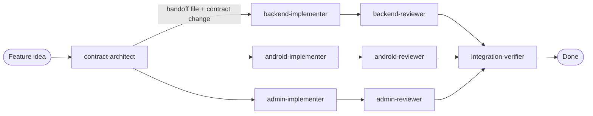

# Agentic development guide

The repo carries a workflow for building it with [Claude Code](https://claude.com/claude-code) agents. Three lanes (backend, mobile, admin) are worked by specialised agents that never touch each other's files and agree through one API contract and one handoff file per feature.

You do not need the agents to work on this project. The same lifecycle, gates and lane rules apply to a person; see [Contributing](../../README.md#contributing) in the root README.

- [Start here](#start-here)
- [How it fits together](#how-it-fits-together)
- [Where things are](#where-things-are)
- [Agents](#agents)
- [Skills](#skills)
- [Agent or main session](#agent-or-main-session)
- [Workflows](#workflows)
  - [Feature development](#feature-development)
  - [Bug fixing](#bug-fixing)
  - [Cross-platform work](#cross-platform-work)
  - [Review and quality assurance](#review-and-quality-assurance)
- [Models](#models)
- [Best practices](#best-practices)
- [Troubleshooting](#troubleshooting)

## Start here

New to the workflow? Watch the [5-minute explainer](https://winechit-dev.github.io/field-incident-reporter/agent-workflow-explainer.html), then build your first feature with five steps. Run each one in the main Claude Code session, from the repo root, and wait for it to finish before the next.

| Step | Type this | Then check |
| --- | --- | --- |
| 1 | `/plan-feature <what you want, in one sentence>` | A new file appears in `docs/handoffs/`. Read its acceptance criteria before going on. |
| 2 | `/implement backend <handoff file>` | The backend lane in the handoff reads `REVIEW`. |
| 3 | `/implement mobile <handoff file>` and `/implement admin <handoff file>` | Each lane reads `REVIEW`. Skip a lane the handoff says has no work. |
| 4 | `/review <lane> <handoff file>`, once per lane | No blockers. If there are, run `/implement` for that lane again, then `/review` again. |
| 5 | `/verify-integration <handoff file>` | Every acceptance criterion passes. |

Three rules cover most mistakes:

- **A change to a request, response or error always starts at step 1.**
- **A question or a one-line fix needs no agent.** Ask or fix in the main session. See [Agent or main session](#agent-or-main-session).
- **Never ask the agent that wrote the code to check it.** Use `/review`.

The rest of this guide explains each part. The other files in this folder are short references:

| File | Read it when |
| --- | --- |
| [`lifecycle.md`](lifecycle.md) | You want the seven steps and when each one counts as done |
| [`quality-gates.md`](quality-gates.md) | You need the exact commands that must pass in a lane |
| [`contract-change.md`](contract-change.md) | A request, response or error has to change |
| [`parallel-work.md`](parallel-work.md) | Two lanes run at once, or two agents might touch one file |
| [`standards.md`](standards.md) | You need the API conventions and domain rules all lanes share |
| [`agent-matrix.md`](agent-matrix.md) | You want to know why an agent has its model and skills, or you are changing one |

## How it fits together



Four ideas hold it together:

1. **Contract first.** [`backend/openapi.yaml`](../../backend/openapi.yaml) changes before any code, and only `contract-architect` edits it.
2. **One lane, one writer.** An agent writes only inside its own directory. What it needs from another lane goes into the handoff file.
3. **The handoff file is the conversation.** Each feature has one file in [`docs/handoffs/`](../handoffs) holding the acceptance criteria, the contract change, each lane's status and the evidence. Agents read and write it; they do not talk to each other.
4. **Red first, then gates, then a second pair of eyes.** Every criterion gets a test that fails before the change. A lane is done when its [quality gates](quality-gates.md) are green and a reviewer on a stronger model finds no blockers.

Every feature goes through the same seven steps, described in [`lifecycle.md`](lifecycle.md): plan → contract → implement → verify → review → document → handoff.

**You are the orchestrator.** No agent in this repo has the tool that starts another agent, so agents never delegate to each other. You, in the main Claude Code session, run each step with one of four commands, and the handoff file carries the state from one agent to the next.

| Command | Runs | Result |
| --- | --- | --- |
| `/plan-feature <description>` | `contract-architect` | A handoff file with acceptance criteria, and the contract change |
| `/implement <backend\|mobile\|admin> <handoff file>` | that lane's implementer | Tests and code in the lane, gate output in the handoff, lane status `REVIEW` |
| `/review <backend\|mobile\|admin> <handoff file>` | that lane's reviewer | A verdict per review section, with `blocker` and `nit` findings |
| `/verify-integration <handoff file>` | `integration-verifier` | A verdict per acceptance criterion across the lanes |

## Where things are

| Path | What it holds |
| --- | --- |
| [`AGENTS.md`](../../AGENTS.md) | The project rules every agent starts from. `CLAUDE.md` only points here. |
| [`backend/AGENTS.md`](../../backend/AGENTS.md), [`mobile/AGENTS.md`](../../mobile/AGENTS.md), [`admin/AGENTS.md`](../../admin/AGENTS.md) | Each lane's boundaries, workflow and skill list. |
| [`.claude/agents/`](../../.claude/agents) | The eight agent definitions: tools, model, preloaded skills, steps. |
| [`.claude/skills/`](../../.claude/skills) | Eleven skills, one folder each, holding the project knowledge an agent loads for a kind of work. |
| [`.claude/commands/`](../../.claude/commands) | The four slash commands that start each step. |
| [`docs/agents/`](.) | The shared process: [lifecycle](lifecycle.md), [quality gates](quality-gates.md), [contract changes](contract-change.md), [parallel work](parallel-work.md), [standards](standards.md), and the [agent matrix](agent-matrix.md). |
| [`docs/handoffs/`](../handoffs) | One file per feature, from [`_template.md`](../handoffs/_template.md). |
| [`docs/adr/`](../adr), [`GLOSSARY.md`](../../GLOSSARY.md) | Decisions and domain terms. |
| [`scripts/`](../../scripts) | `check-agents.sh` (the workflow files agree), `integration/run-integration.sh` (the lanes agree), `check-forbidden-terms.sh`. |

## Agents

| Agent | Use it when | Writes | Can edit files |
| --- | --- | --- | --- |
| `contract-architect` | A feature starts, or anything changes a request, response, error or domain term | `backend/openapi.yaml`, `GLOSSARY.md`, `docs/adr/`, handoff files | yes |
| `backend-implementer` | Endpoints, rules, seed data, API tests | `backend/` except the contract | yes |
| `backend-reviewer` | A backend lane reads `REVIEW` | nothing | no |
| `android-implementer` | Anything in the Kotlin Multiplatform app, Android and iOS | `mobile/` | yes |
| `android-reviewer` | A mobile lane reads `REVIEW` | nothing | no |
| `admin-implementer` | Anything in the Next.js dashboard | `admin/` | yes |
| `admin-reviewer` | An admin lane reads `REVIEW` | nothing | no |
| `integration-verifier` | Every lane reads `DONE` | nothing | no |

Reviewers and the verifier have no edit tool, so they cannot quietly fix what they find. No agent has a browser. Each agent's model is in [Models](#models); what each takes in and hands on is in the [agent matrix](agent-matrix.md).

There is no separate architect, tester or security agent per lane. `contract-architect` designs across lanes, implementers write their own tests first, and security and UI checks are sections of each review skill.

## Skills

A skill is a short document of project knowledge. Two things load one:

- **Preloaded:** an agent's definition lists it under `skills:`, so its full text is in the agent's context from the start.
- **On demand:** the agent, or you in the main session, loads it when the work matches its description. You can also type its name, for example `/mobile-debugging`, or say "load the `admin-ui` skill first" in a prompt.

| Skill | Use it when | Preloaded into | Also loaded on demand by |
| --- | --- | --- | --- |
| `backend-api` | Changing a route, a rule, an error code, seed data or an API test | `backend-implementer`, `backend-reviewer` | |
| `backend-review` | Reviewing a backend diff | `backend-reviewer` | `backend-implementer` (self-check) |
| `mobile-architecture` | Deciding where code goes; platform code, Koin, coroutines, Gradle | `android-implementer`, `android-reviewer` | |
| `mobile-testing` | Choosing, writing or running a mobile test | `android-implementer` | |
| `mobile-data-sync` | DTOs, Room, the outbox, the sync engine, Ktor | | `android-implementer`, `android-reviewer` |
| `mobile-compose-ui` | Screens, view models, navigation, theme, accessibility | | `android-implementer`, `android-reviewer` |
| `mobile-debugging` | A build, test or device failure with no obvious cause; a slow screen | | `android-implementer`, `integration-verifier` |
| `mobile-review` | Reviewing a mobile diff | `android-reviewer` | `android-implementer` (self-check) |
| `admin-architecture` | Routes, server actions, API calls, filters, forms, session, tests | `admin-implementer`, `admin-reviewer` | |
| `admin-ui` | Components, layout, copy, dark mode, accessibility | | `admin-implementer`, `admin-reviewer` |
| `admin-review` | Reviewing an admin diff | `admin-reviewer` | `admin-implementer` (self-check) |

`contract-architect` uses no skills; its rules are in [`contract-change.md`](contract-change.md). Two skills that ship with Claude Code are also used: `run` (launching the app on an emulator) and `claude-in-chrome` (the dashboard's browser check, done by the main session).

## Agent or main session

A subagent starts with an empty context: it reads the handoff, the lane rules and its skills before doing anything. That cost is worth paying for a whole criterion and wasted on a one-line change.

| The task | Do this |
| --- | --- |
| A question about the code, or "where is X handled?" | Ask in the main session. Add "do not edit any files". |
| A typo, a copy change, a one-line fix in one lane | Fix it in the main session. Load the lane's skill if conventions matter. |
| One acceptance criterion or more, in one lane | `/implement` |
| Anything that changes a request, response, error or domain term | `/plan-feature`, even when it looks like a one-lane change |
| Checking finished work | `/review`, never the session or agent that wrote it |
| A build or device failure with no obvious cause | `/mobile-debugging` in the main session |
| Two lanes with no dependency on each other | Two `/implement` runs in parallel, each in its own worktree |

To give an agent a narrower job than a whole handoff, name it in the prompt:

```
Use the android-implementer agent on docs/handoffs/012-incident-priority.md, criterion 3 only:
the Urgent label on the list screen. Load the mobile-compose-ui skill first.
```

## Workflows

Open the repo in Claude Code. `012-incident-priority.md` is an example file name; yours is whatever `/plan-feature` creates. The features and bugs in the example prompts are made up.

### Feature development

**1. Plan it and change the contract**

```
/plan-feature Operators can mark an Incident as urgent, and Technicians see an Urgent label in the app
```

`contract-architect` writes `docs/handoffs/<id>-<slug>.md` with Given/When/Then criteria for each lane, changes `openapi.yaml`, and lists the lane tasks in order. Read the handoff before going on: the criteria are what every later step is judged against.

**2. Ask for analysis before any code** (optional)

```
Read docs/handoffs/012-incident-priority.md and the mobile-data-sync skill. Explain what has to
change in mobile/core/data for this, and what could go wrong with Incidents already queued
offline. Do not edit any files.
```

**3. Implement, backend first**

```
/implement backend docs/handoffs/012-incident-priority.md
/implement mobile docs/handoffs/012-incident-priority.md
/implement admin docs/handoffs/012-incident-priority.md
```

The implementer writes a failing test per criterion, makes it pass, runs the lane's gates, pastes the output under "Evidence" in the handoff, and sets its lane to `REVIEW`.

**4. Review each lane**

```
/review backend docs/handoffs/012-incident-priority.md
```

Blockers go back through `/implement`, then review again. When none remain, the main session records the outcome in the handoff and sets the lane to `DONE`.

**5. Verify across the lanes and finish**

```
/verify-integration docs/handoffs/012-incident-priority.md
```

`integration-verifier` runs each criterion across the lanes, including [`scripts/integration/run-integration.sh`](../../scripts/integration/run-integration.sh), and gives a verdict per criterion. The feature is done when every lane reads `DONE` in the handoff, every criterion passes, and each lane's README matches its code. The main session then updates the root `README.md` if the feature changed anything it describes.

### Bug fixing

There is no separate bug command. A fix uses the same parts, sized to the bug.

**1. Investigate without changing anything**

```
Without changing any files, explain how the dashboard decides which fields "Start work" sends,
and where that is tested.
```

**2. Find the root cause and reproduce it**

For mobile, the `mobile-debugging` skill is a diagnosis loop for builds, tests, devices and stuck sync:

```
/mobile-debugging An Incident stays on "Waiting to sync" after the emulator comes back online.
Find the cause and show me the reproduction before fixing anything.
```

Only mobile has a debugging skill. For backend and admin, describe the failing request or page and ask for a reproduction first:

```
PATCH /incidents/{id} as u-op-1 with {"assignee": null} returns 422 but the contract allows null.
Load the backend-api skill, reproduce it with a failing test in backend/test/api.test.js, and
show me the cause. Do not fix it yet.
```

**3. Fix it, by size**

| The fix | Do this |
| --- | --- |
| A few lines in one lane, contract untouched | Fix it in the main session with the lane's skill loaded. Keep the failing test from step 2. |
| Larger, or you want the review trail | Write a handoff from [`_template.md`](../handoffs/_template.md) with the bug as a criterion ("Given …, When …, Then …"), then `/implement <lane> <handoff>`. |
| The contract itself is wrong, or the fix changes a response or error | `/plan-feature Fix: <what is wrong>`, so `contract-architect` changes the contract first. |
| The cause is in another lane than the symptom | Fix it in the lane that owns the cause. Never patch around it in the lane that shows it. |

```
Write docs/handoffs/012-null-assignee.md from the template: backend lane only, one criterion for
the 422 on a null assignee described above. Then run /implement backend on it.
```

**4. Validate**

Run the lane's gates, then `/review <lane> <handoff>` for anything beyond a trivial fix. Run `scripts/integration/run-integration.sh` when the fix touches sync, DTOs, the contract, filters or what "Start work" or "Resolve" sends.

### Cross-platform work

**Order.** contract → backend → mobile and admin (in parallel) → integration check. Mobile and admin can start as soon as the contract change is merged: they build against `openapi.yaml` and the seed data, and need a running backend only for the integration check.

**Keeping the contract consistent.** Each lane follows the contract in a different way, so each fails in a different way:

| Lane | Follows the contract by | A mismatch shows up as |
| --- | --- | --- |
| Backend | A test per documented status code | A red API test |
| Admin | `npm run gen:api` regenerates `schema.d.ts` | A type error, or a diff after `gen:api` |
| Mobile | DTOs and mappers updated by hand | Nothing automatic: the reviewer checks field by field. A new enum value needs its own mobile task |

**Dependencies between lanes.** A lane that needs something from another writes it in the handoff under "Contract needs" or "Open questions" and continues with what it can. You then run the agent that owns it:

```
The admin lane recorded a contract need in docs/handoffs/012-incident-priority.md. Use the
contract-architect agent to resolve it, then tell me which lanes have new work.
```

**Running lanes in parallel.** Once the backend lane is merged:

```
Run /implement mobile and /implement admin on docs/handoffs/012-incident-priority.md in parallel,
each in its own git worktree.
```

Each parallel agent works on a branch named `<id>-<lane>`. Two mobile agents may run together only on different modules, with the interface between them agreed in the handoff first. Shared files, merge order and conflict rules: [`parallel-work.md`](parallel-work.md).

**Integration.** `/verify-integration <handoff>` after every lane reads `DONE`. What the screens show is still checked by hand: the dashboard in a browser by the main session, the app on an emulator.

### Review and quality assurance

**Request an independent review.** Always through `/review`, which starts the lane's reviewer in a fresh context with read-only tools:

```
/review mobile docs/handoffs/012-incident-priority.md
```

The reviewer re-runs the gates itself instead of trusting the pasted evidence, and reports a verdict per section of its review skill. Each finding is a `blocker` or a `nit`, with file, line and the failing scenario.

**Handle the feedback.**

```
/implement mobile docs/handoffs/012-incident-priority.md
Fix only the blockers from the review above. Leave the nits unless they are one-line changes.
```

Then `/review` again. A lane merges with zero blockers; nits are your call.

**Run the gates yourself.** The commands for each lane are in [`quality-gates.md`](quality-gates.md) and in the root README under [Testing and quality](../../README.md#testing-and-quality).

```
Run the admin gates from docs/agents/quality-gates.md and show me the final lines of each.
Do not change any files.
```

**Check a UI change.** Lane agents have no browser or device:

```
Start the backend and the dashboard, open /incidents with the claude-in-chrome skill, and check
the Unassigned filter in light and dark mode. Add what you saw under Evidence in the handoff.
```

## Models

### What is configured

Each agent file sets `model:` to a Claude Code alias. Three are in use: `haiku`, `sonnet` and `opus`. An alias resolves to the current model of that tier for your account and provider, so the repo does not pin versions; run `/model` in Claude Code to see what each resolves to for you.

| Tier | Strength | Speed and cost | Used here for |
| --- | --- | --- | --- |
| `haiku` | Routine, well-specified work | Fastest, cheapest | The backend implementer |
| `sonnet` | Everyday coding | Middle | Implementers that write the most code; the verifier; the backend reviewer |
| `opus` | Careful reasoning over a lot of code | Slowest, most expensive | Planning the contract; reviewing mobile and admin |

### Assignments

| Agent | Assigned model | Task complexity | Reason |
| --- | --- | --- | --- |
| `contract-architect` | `opus` | High | Few, short runs whose mistakes are paid for by three lanes |
| `backend-implementer` | `haiku` | Low to medium | The most routine lane: one rules file, one test file, and a test per status code that catches a wrong answer at once |
| `backend-reviewer` | `sonnet` | Medium | Small diffs, but the server is where authorization holds |
| `android-implementer` | `sonnet` | Medium to high | Most of the tokens: test-first Kotlin for two platforms, long Gradle loops |
| `android-reviewer` | `opus` | High | Offline sync fails in ways only careful reading finds; reads much, writes little |
| `admin-implementer` | `sonnet` | Medium to high | Strict TypeScript and a Next.js version whose docs must be read, not recalled |
| `admin-reviewer` | `opus` | High | Server and client boundaries, caching and access checks are easy to get subtly wrong |
| `integration-verifier` | `sonnet` | Medium | Runs scripts and an emulator and compares results with criteria |

Two rules explain the table:

- **Implementers run on the cheaper model** because they produce most of the tokens: long edit, build and test loops.
- **Each reviewer runs one tier above its lane's implementer**, so the check does not share the author's blind spots. A reviewer reads much and writes little, so the stronger model costs less there than it would for an implementer.

The agent files in [`.claude/agents/`](../../.claude/agents) are the source of truth; the fuller reasoning is in the [agent matrix](agent-matrix.md). `scripts/check-agents.sh` fails if this table and the agent files disagree, or if an agent has no model set.

### Changing the model

| You want | Do this |
| --- | --- |
| A stronger model for one task | Say so in the prompt (below). The main session passes the model for that run only; the agent file is unchanged. |
| A different model for an agent from now on | Edit `model:` in its file under `.claude/agents/`, update the reason in [`agent-matrix.md`](agent-matrix.md) and the table above, then run `scripts/check-agents.sh`. |
| A pinned version instead of a moving alias | Put a full model ID in `model:` in place of the alias. |
| A different model for the main session | `/model <alias>` in the session, or `claude --model <alias>` at startup. This does not change the agents: each sets its own model. |

```
Run /implement mobile on docs/handoffs/012-incident-priority.md with model opus.
```

A per-run model takes an alias (`haiku`, `sonnet`, `opus`), not a full model ID. The `CLAUDE_CODE_SUBAGENT_MODEL` environment variable has no effect here, because every agent sets its own model and that takes precedence.

`/implement` already raises the model by itself in three cases, so you rarely need to:

| Lane | Raised to | When the handoff |
| --- | --- | --- |
| backend | `sonnet` | changes who may do what, changes file handling, or was handed back under "Open questions" |
| mobile | `opus` | changes `SyncEngine`, the outbox format or the Room schema, or was handed back under "Open questions" |
| any | the next tier up | was handed back by the implementer under "Open questions" |

### Using models efficiently

- **Match the model to the task, not to your worry.** Routine, test-backed work goes to the assigned model. Raise it for the cases above: sync, schema, authorization, or a second failure.
- **Escalate on evidence.** An implementer that fails the same way twice records the reproduction under "Open questions" and stops. That is the signal to re-run one tier up, not before.
- **Do not raise the model to fix a vague task.** A sharper criterion in the handoff helps more than a stronger model.
- **Do not run an agent twice for confidence.** One implementer and one reviewer per lane. A second review is only for a diff that changed after the first.
- **Keep an agent's context small.** Name the handoff, the criterion and the skill. Do not paste files the agent can read, and do not ask one agent to cover two lanes.
- **Run independent work in parallel.** Mobile and admin after the contract is merged. Parallel runs save time, not tokens.
- **Use the main session for small things.** Starting an agent costs a full read of the handoff, the lane rules and its skills.
- **Review whatever any model wrote.** `/review` and the gates apply equally to `haiku` and `opus` output. A stronger author is not a substitute for a test that failed first.

## Best practices

- **Pick the agent by the directory the change lands in.** A change to a request, response, error or domain term always starts with `/plan-feature`.
- **Never ask an agent to edit another lane.** Have it write the need under "Contract needs" or "Open questions" in the handoff, then run the right agent.
- **Review in a fresh context.** Use `/review`; do not ask the agent that wrote the code whether it is correct.
- **Parallel only when independent.** See [Cross-platform work](#cross-platform-work).
- **Read the handoff before step 3.** Wrong criteria cost more than any model choice.
- **When you change the workflow itself**, keep each fact in one place: the model and skills in the agent file, the reasons in the [agent matrix](agent-matrix.md), the knowledge in the skill. Then run `scripts/check-agents.sh`. Add a skill only when an agent keeps getting the same thing wrong; add an agent only when a job needs its own context or its own permissions.

## Troubleshooting

| Symptom | Cause and fix |
| --- | --- |
| An agent runs on the wrong model, or without its skills, after you edited its file | Claude Code picks up an edited agent file within a few seconds. If the next run still uses the old definition, restart Claude Code. |
| `claude --agent <name>` has no skill text in context | Skills preload only when the agent runs as a subagent. Start it through a command or "Use the … agent", or load the skill by name. |
| An agent or skill is not listed at all | Its frontmatter did not parse. Run `scripts/check-agents.sh` and `claude plugin validate .claude/agents`. A `description` containing `: ` must be reworded or quoted. |
| The admin implementer says the browser check is owed | Lane agents have no browser tools. The main session does that check with the `claude-in-chrome` skill, which needs the Claude in Chrome extension. |
| The mobile emulator check cannot run | It needs a running Android emulator and the backend on port 3000. Without one, the handoff records the check as not done. |
| Integration tests show as skipped | They run only through `scripts/integration/run-integration.sh`, which starts its own API. |
| An implementer stops with "Open questions" | It hit the same failure twice. Read the reproduction it recorded, then re-run `/implement`; the command passes a stronger model. |
| Two agents changed the same file | They were not in separate worktrees, or one left its lane. The later lane rebases; see [`parallel-work.md`](parallel-work.md). |
| An agent tries to start another agent and cannot | By design: no agent here has that tool. Run the next step yourself with its command. |

**What has been checked, and what has not.** `scripts/check-agents.sh` confirms the files agree with each other. Starting each of the eight agents from a fresh session confirmed its model and preloaded skills. Reviewers have no edit tool and no agent has a browser, as intended. Features have been run through the workflow (handoffs [005](../handoffs/005-unassigned-filter.md) onward), and the gaps that showed up were closed, but the skills and model settings are still young: expect to tune them, the `haiku` choice for the backend lane first.
